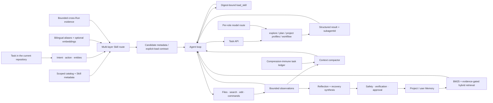

# CodeLoop

<p align="center">
  <strong>An evidence-driven local coding-agent runtime in Python.</strong>
</p>

<p align="center">
  Multi-layer Skill routing narrows the decision space. Long tasks retain critical state.
  Bounded sub-agents extend execution. Policy-qualified recoveries become reusable lessons.
</p>

<p align="center">
  <a href="./README.zh-CN.md">简体中文</a>
  ·
  <a href="./docs/PORTFOLIO_CASE_STUDY.en.md">3-minute case study</a>
  ·
  <a href="./docs/CONTRIBUTION_AUDIT.md">Full contribution map</a>
  ·
  <a href="./CONTRIBUTIONS.md">Contribution boundary</a>
  ·
  <a href="#quick-start">Quick start</a>
</p>

<p align="center">
  <a href="https://github.com/zrb3052796119/CodeLoop/actions/workflows/ci.yml"></a>
  
  
</p>

CodeLoop is a substantial derivative of
[MiniCode Python](https://github.com/QUSETIONS/MiniCode-Python), not a
from-scratch agent. It keeps the compatible `minicode` import path and
`minicode-py` executable, then extends and rebuilds parts of the runtime around
four questions:

1. Can Skills pass through layered directory/capability context, lexical and
   entity signals, bilingual aliases, optional embeddings, and bounded
   historical evidence—and still abstain when evidence is weak?
2. Can repeated context compaction preserve goals, facts, rejected approaches,
   tool-call integrity, and the latest instruction?
3. Can sub-agents be delegated work without losing lifecycle control,
   attribution, or a shared budget?
4. Can a verified tool failure become a safe lesson for the next conversation?

The short answer is **yes for the tested scopes**, with important limitations
documented below. The project favors inspectable evidence and fail-closed
contracts over broad capability claims.

These are four peer runtime-engineering tracks. The three-minute Memory case
is featured because it has the most complete warm/cold paired evidence; it is
one vertical slice, **not the scope of the whole project**.
Evaluation, configuration, privacy, and cross-platform reliability form a
support layer across them, not a fifth capability track.

> **Reuse notice:** this derivative repository currently has no root license,
> and the inspected Python upstream did not expose one. The code can be viewed
> and evaluated here, but public visibility is not a redistribution or
> commercial-use grant. See [Lineage and Credits](#lineage-and-credits).

## Portfolio Snapshot

| Item | Scope |
| --- | --- |
| Role | Maintainer and primary post-import Git author. Several commits carry AI co-author trailers; the history does not justify a “worked alone” or ownership-percentage claim. The exact upstream delta is not reconstructable because the imported baseline did not record an upstream revision. |
| Period | 2026-07-27 to present |
| Main ownership | Multi-layer Skill routing and bounded feedback, context-fidelity repairs, bounded sub-agent lifecycle/model routing, persistent-learning evidence loop, and evaluation/release discipline. |
| Status | Research/engineering prototype with a usable local CLI; not presented as a production-safe or generally benchmarked agent. |
| Hardest design choice | Make learned signals useful without granting authority: Skill history may only rerank independently admitted candidates, while Memory feedback may only affect entries actually rendered for that turn. |

## Evidence at a Glance

**Governance status: Phase 1 passed acceptance at `e6492f9b` and merged via [PR #2](https://github.com/zrb3052796119/CodeLoop/pull/2) into main `ed21acb3`.** The first extraction removes 497 lines from `run_agent_turn`, moves all four target closures, and uses at most 11 parameters per new function. The [acceptance record](./docs/release-baseline-2026-10-24.md#phase-1-最终支持矩阵) documents the complete supported-platform CI and one infrastructure retry. The post-merge seed-52 run exposed one deadline-fixture failure; its deterministic repair is awaiting full CI, as recorded in the acceptance record. [Phase 2 r3](./docs/real-task-comparison-r3-2026-10-25.md) is still running; efficiency claims and default-path decisions await its complete report.

First, the contract surface for the four tracks and their support layer:

| System evidence | Result | What it does—and does not—show |
| --- | ---: | --- |
| [Repository regression suite](./artifacts/governance-trial-2026-10-24/phase1-supported-matrix/README.md) | **Linux: 14,952 passed / 19 skipped; macOS: 14,963 passed / 8 skipped, per Python version** | Phase 1 candidate `e6492f9b`, Python 3.11 and 3.12, CI seed `50`; all four supported runtime jobs have zero failures/errors. Native Windows has passing experimental package checks and separate, still-failing full-runtime diagnostics. Counts are not added across environments. |
| [Skill-routing gate](./docs/agent-quality-gates.md) | **60/60 legacy; 96/96 joined routing decisions** | The joined production-shaped development set also records 84/96 full cases; its 12 residuals are intent/context labels, not Skill decisions. Both are offline with `remoteCallCount=0`, not live Qwen, a blind production holdout, or an external benchmark. |
| [Repeated-compaction gate](./docs/agent-quality-gates.md) | **12/12 gate + 60/60 stress** | Forced one-to-five-round cases cover summary chains, rejected approaches, the task ledger, latest instruction, loaded Skill, and tool turns across four history scales and three marker layouts. Proves the frozen contract, not zero drift in every long conversation. |
| [Paired context-compaction study](./docs/context-compaction-experiment-study.md) | **12/12 pairs complete; 24 cases** | Canonical/control provider input tokens were 4,288,270 vs 6,011,480 (**-28.7% aggregate; 22.7% median paired**, exact `p=0.00537`). Strict success was 9/12 vs 10/12 because five cases hit remote `IncompleteRead`; all executable tests and protected markers still passed. This supports token efficiency, not a quality-neutrality claim. |
| [Recorded-task gate](./docs/agent-quality-gates.md) | **50/50** | Real model/runtime recordings from isolated synthetic repositories: 10 categories and 30 writing tasks. The command re-evaluates sealed evidence offline; profile `a` accepts fresh results for the same manifest but does not automatically rerun the provider. Not an external certification. |
| [Live parent/child model route](./docs/model-routing-live-acceptance-2026-08-23.md) | **4/4 actors × 2 rounds** | Parent, Explore, Plan, and General each made one HTTP request per round; outbound and provider-reported model IDs agreed. This is a sanitized curated projection, not a provider-signed receipt. |

### Memory Efficiency Vertical Slice

Here, **Memory / warm** is a new Run that receives the relevant approved
lesson; **cold** repeats the same task without it. Memory currently has the
most complete paired efficiency data, so it is listed separately:

| Paired/replay evidence | Result | What it does—and does not—show |
| --- | ---: | --- |
| [Paired path-recovery study](./docs/2026-08-21--persistent-memory-large-study--r1--robustness-check.md) | **48 Memory / cold pairs** | Reuse-stage target Turns: tools 50 vs 240 (**-79.2%**); input tokens 652,911 vs 1,539,738 (**-57.6%**). Lesson acquisition has an upfront cost. Synthetic, read-only recovery tasks only. |
| [Paired non-path study](./docs/2026-08-22--non-path-persistent-memory--r1--robustness-check.md) | **36 Memory / cold pairs** | Mean tools: 7.50 vs 11.50 (**-34.8%**); strict success: 32/36 vs 28/36. Results vary materially by lesson category. |
| [Large-file repair replay](./docs/north-star-memory-compaction-repairs-2026-08-21.md) | **5/5 run-external local oracles** | Model calls 25→5 and input tokens 257,088→49,541 in one stochastic replay. The oracles ran outside the Agent Run but were not third-party certification; useful fault-recovery evidence, not a causal effect estimate. |

Start with the [3-minute Memory case](./docs/PORTFOLIO_CASE_STUDY.en.md) for one
complete failure → recovery → lesson → next-conversation injection chain, then
use the linked reports to inspect the broader paired results. Its public
entry-ID join is a curated, hash-linked attestation; the privacy-held raw
sidecars are not included, so this is not an independently replayable proof of
the full provider trace.

## What Changed from the Imported Baseline

The initial imported repository already contained the main agent loop,
provider adapters, local tools, TUI, `CyberneticOrchestrator`, context
compaction, Memory, Skill routing, and a synchronous task/sub-agent tool.
CodeLoop should not claim those as original components.

| Area | CodeLoop work after the imported baseline | Verification surface |
| --- | --- | --- |
| Multi-layer Skill routing | On top of the inherited deterministic directory/Skill scorer: context-aware compound operations, operation-by-topic lanes, real abstention/clarification, bilingual intent and aliases, optional Qwen/OpenAI-compatible embeddings, strict explicit-invocation grammar, candidate-margin gates, digest-bound loading, and bounded cross-Run reranking that only affects independently admitted candidates. | Frozen 60-case router gate plus a 96-case joined parse-to-prompt development challenge, semantic cache/degradation, authority, digest-loader, and evidence tests. |
| Context fidelity | Added summary-of-summary chaining, a compression-immune ledger for goal/constraints/typed facts/failure codes, atomic provider tool turns, provider-usage calibration, and unchanged-state retry identity; connected forced paths to the inherited breaker. | Repeated-compaction gate and large-file replay. |
| Multi-agent runtime | Asynchronous `spawn` / `poll` / `cancel` for read-only `explore/plan`, structured results, `subagentId` journal joins, shared turn budgets, deadlines, and per-role OpenAI-compatible model routing. | Lifecycle, cancellation, result-schema, routing, journal, and budget tests. |
| Persistent Memory | On top of inherited storage, generic recovery synthesis, sanitization, approval, lexical retrieval/reranking, content hashes, and rendered-entry feedback: corroborated/idempotent feedback, quarantine/projection hygiene, broader operational recovery, canonical evidence-gated hybrid retrieval, and stricter acceptance attribution. | Paired warm/cold studies, V1–V5 deterministic contracts (V5 live/provider run pending), and the Memory regression matrix. |
| Cross-cutting support (not a fifth capability track) | Added global credential boundaries, privacy-safe failure projections, deterministic profiles, sealed manifests, and external oracles while hardening the inherited CI, CLI/TUI/dashboard, and permission surfaces for concurrency and deadline failures. Native Windows remains experimental after the platform audit; see the support policy. | CI, local full-suite, clean-checkout, and live-routing checks. |

The [full contribution map](./docs/CONTRIBUTION_AUDIT.md) binds each track to
code, tests, and commits. The repository lineage and explicit
inherited/added/rebuilt inventory live in
[CONTRIBUTIONS.md](./CONTRIBUTIONS.md).

## How the Runtime Fits Together



The provider still decides which permitted tool to call. The surrounding
runtime records structured observations, constrains retries and delegation,
and only turns selected high-confidence outcomes into durable state.

## Core Capabilities

### 1. Multi-layer Skill routing that can abstain

The decision path is not “a regex matched, so inject the whole Skill.” The
runtime first discovers metadata from project, user, and compatibility roots,
then parses intent, action, entities, and bilingual keywords. Directory,
capability, tool, and source scores provide coarse ranking context; admission
still requires query-specific lexical/entity evidence, a bilingual alias, an
embedding above its signal threshold, or a strict explicit invocation. Weak
evidence is limited to the strongest suggestion. With no evidence, the router
selects nothing and the prompt retains only a name-only inventory—not rich
candidate descriptions or tool metadata.

The optional semantic layer supports Qwen/DashScope and other
OpenAI-compatible embedding endpoints. Skill vectors are cached by content
digest; provider failures enter a shared cooldown and degrade to the local
alias floor. Explicit `$skill`, English `Use ... Skill`, and Chinese invocation
grammar outrank inferred signals, while negated references and ordinary name
collisions gain no authority. An explicitly requested Skill must be loaded
before the final answer. Loading is bound to the discovered source, directory,
path, and SHA-256 digest, preventing route-old/load-new drift, ambiguous bare
names, and symlink escape.

Cross-Run evidence may apply a capped rank adjustment only after strict sample,
verification, user-signal, and confidence gates—and only to a candidate that
the current query admitted independently. It cannot create relevance, defeat
abstention, override an explicit request, rewrite a Skill, or promote a new
version. The frozen 60-case gate covers 40 positive/explicit and 20
abstention/adversarial cases and currently records 60/60 with
`remoteCallCount=0`. It validates the deterministic routing contract; it is
not a live Qwen call. Transport mocks, cache/degradation tests, and a separate
smoke path cover the remote adapter boundary.

A second 96-case joined challenge exercises the actual parse, bounded context,
operation-by-topic candidate lanes, explicit authority, final decision, and
prompt projection together. It currently records 96/96 correct routing
decisions and 84/96 full cases; the 12 full-case residuals are ten conservative
off-domain intent-taxonomy labels and two context-use labels. Because the set
was used during implementation, it is a regression development set rather
than a blind production estimate.

An optional context-aware intent fallback can make one budgeted, tool-free
model call only after deterministic parsing abstains. It is disabled by
default, preserves negation and explicit-authority boundaries, and accepts only
strict calibrated advisory operations. See the
[semantic intent operating contract](./docs/intent-semantic-classifier.md),
[Skill routing feedback](./docs/skill-routing-feedback.md), and the
[full contribution map](./docs/CONTRIBUTION_AUDIT.md).

### 2. Context compaction that preserves task state

CodeLoop uses one canonical compaction path. It preserves provider-native
tool-call/result pairs, chains each new summary through the previous summary,
and re-injects the latest user instruction. A parent-owned task ledger keeps a
bounded goal, explicit constraints, typed verification facts, and failed-tool
error codes outside the lossy summary cycle. It does not semantically infer a
complete project plan or arbitrary open work. Provider-reported usage
calibrates the local estimator when available.

The frozen gate also carries a rejected-approach summary sentinel through
repeated rounds. That state is preserved by the summary chain; it is not a
claim that the task ledger infers or maintains an arbitrary decision history.

Failed compactions are keyed to the unchanged message state, deduplicated, and
bounded by a circuit breaker. A materially changed state may retry; an
unchanged state cannot oscillate indefinitely.

See [context repair report](./docs/north-star-memory-compaction-repairs-2026-08-21.md)
and [quality-gate contract](./docs/agent-quality-gates.md).

### 3. Bounded multi-agent collaboration

Delegation starts from the task tool's own description, which carries the
working heuristics: delegate when answering means reading across several
files; search directly for a single known fact; never repeat a search you
already delegated; every prompt must be self-contained. Read-only agents
accept a caller-stated breadth (`medium` / `very thorough`) and adapt their
sweep accordingly.

The routing rules escalate with task risk: small low-risk edits use the
parent's fast-edit
path (zero agents, bounded per-diff/per-turn budgets), scoped verified
changes take an Executor→Verifier route (Verifier is deterministic code),
and larger or riskier changes enter Analyst→Executor→Verifier→Reviewer.
An Adjudicator handles supported risk-classification conflicts; ordinary
parallel exploration disagreements return to the parent for evidence checking.
Read-only investigations may run concurrently. Escalation from the fast-edit path is
automatic once its budgets are exceeded.

| Entry point | Typical work | Lifecycle |
| --- | --- | --- |
| `explore` | Read-only repository discovery; parallel-safe | May run asynchronously with `spawn` / `poll` / `cancel`; several issued in one step run concurrently. |
| `plan` | Read-only analysis and design | Same async lifecycle. |
| Project profiles | Additional read-only specialists defined as data — `.mini-code/agents/*.md` | Loaded fail-closed (reserved built-in names cannot be overridden, tools restricted to the read-only whitelist); synchronous only. |
| `workflow` | Schedules Analyst, Executor, Reviewer, and Adjudicator as needed | Synchronous orchestration, deterministic verification, isolated snapshot workspace; the parent continues remaining work after promotion. |
| `general` | Legacy embedder compatibility; the Executor's underlying model route | Direct delegation is rejected by the production Agent Loop. |

Guardrails stay deterministic: role permissions bind to frozen evidence,
promotion freshly hashes parent bytes under a cross-process lock, one
implementation repair by default (host policy 0–2), and a read-only
delegation circuit breaker stops further delegation after two consecutive
failures in a turn. Only unconditional continuation verdicts resume a
blocked workflow. Children and visual-model calls share the
parent turn budget. Workflow Executors run in restricted snapshot directories;
the legacy `general` path uses killable subprocesses with budget leases.

Delegated implementation goes directly to `workflow`; an external Plan is
not a prerequisite, and the internal Analyst is selected by risk. Repeated
inspection and approaching deadlines produce bounded progress feedback.
Without an explicit role override, a structured Executor uses the remaining
shared call allowance after reserving calls for mandatory review and the
parent response. Working, retry and closing calls share that cap; token and
time limits are unchanged. The Executor must submit its structured result
while tools are available. A tool-free final summary cannot authorize promotion.

Results come back as a typed `summary / files / risks / verification`
envelope with a stable `subagentId`. Because live models sometimes finish
without submitting the typed note, the tool enforces it: an imperative
instruction up front, then one bounded closing reminder (≤2 steps) that
preserves the completed investigation while recovering the note; the result
header states whether the contract
was reported, recovered, or refused. Telemetry stays content-free —
journal and completion events carry counts, ids, and closed enums only.
Formal result slots belong to one child run and seal on return. Async
completion is acknowledged after its result reaches the parent's transcript.

**Continuation**: a finished read-only run can be resumed with
`continue_subagent_id` instead of re-exploring. The fixed scripted benchmark
records a follow-up with **0 vs 3 tool calls** and **1 vs 4 model turns**
compared with a scripted fresh search; these are not average live-task savings.
Adoption is measurable from journals
(content-free marker, `scripts/analyze_continuation_adoption.py`). See
[sub-agent continuation](./docs/subagent-continuation.md) and
[project agent profiles](./docs/subagent-profiles.md). Archived scenario
acceptance and scripted savings do not establish an improvement over a
single Agent; see [effectiveness evidence and comparison plan](./docs/multi-agent-effectiveness.md).

The default explore turn ceiling (12) was kept after a live 8-vs-12 A/B:
two frozen cases genuinely needed 9 turns, and most finish in 5–6 either
way (`docs/measurement-round.md`). An optional dedicated
OpenAI-compatible route sends child roles to a lighter model while the
parent keeps the primary model ([sub-agent model routing](./docs/subagent-model-routing.md));
the Anthropic adapter adds three prompt-cache breakpoints (system, tool
catalog, conversation tip) with a kill-switch and a marker-free fallback
retry ([prompt caching](./docs/prompt-caching.md)).

### 4. Persistent lessons with a real evidence chain

The Memory write path is not “save the model's summary.” A durable recovery
lesson must be derived from structured events that connect a failed action to
a corrected action and a policy-qualified successful result. Automatic
approval is limited to strong recovery signals; ambiguous claims remain
pending or are rejected. “Verified recovery” can mean targeted corrected-tool
evidence and is not always an independent test command—the featured case makes
that distinction explicit. Stored entries are content-hash bound, sanitized,
auditable, and can be quarantined or downgraded by later feedback.

On the read path, canonical retrieval combines lexical evidence with an
optional hybrid channel. Remote Memory embeddings require a separate explicit
authorization because approved lessons may leave the machine. Rendered Memory
records exact entry IDs so later success or correction can be attributed to
what was actually injected.

See [Memory hybrid retrieval](./docs/memory-hybrid-retrieval.md),
[large paired study](./docs/2026-08-21--persistent-memory-large-study--r1--robustness-check.md),
and [non-path paired study](./docs/2026-08-22--non-path-persistent-memory--r1--robustness-check.md).

## Quick Start

Linux and macOS are the supported runtime targets for this governance trial. Native Windows instructions are experimental: package/entry checks pass, but the complete runtime suite does not. [Platform scope, diagnostics and porting work](./docs/platform-support.md).

### 1. Install CodeLoop

macOS / Linux:

```bash
git clone https://github.com/zrb3052796119/CodeLoop.git
cd CodeLoop
python3 -m venv .venv
source .venv/bin/activate
python -m pip install -e ".[dev]"
```

Windows PowerShell (experimental):

```powershell
git clone https://github.com/zrb3052796119/CodeLoop.git
Set-Location CodeLoop
py -3.12 -m venv .venv
& .\.venv\Scripts\Activate.ps1
python -m pip install -e ".[dev]"
```

### 2. Create one global model configuration

macOS / Linux:

```bash
mkdir -p ~/.mini-code
chmod 700 ~/.mini-code
cp .env.example ~/.mini-code/.env
chmod 600 ~/.mini-code/.env
```

Windows PowerShell (experimental):

```powershell
$configDir = Join-Path $HOME ".mini-code"
New-Item -ItemType Directory -Force $configDir
Copy-Item .env.example (Join-Path $configDir ".env")
```

Edit `~/.mini-code/.env` and enable exactly one primary provider profile. The
checked-in example covers Anthropic, OpenAI, OpenRouter, and custom
OpenAI-compatible endpoints. Never commit a real key.

```bash
python -m minicode.main --validate-config
```

The untouched example deliberately has no active credential and must fail
until edited. Validation checks local structure and safety rules; it does not
make a provider request or prove that the credential authenticates remotely.

Process environment variables take precedence. The legacy
`~/.mini-code/settings.json` remains a compatibility fallback. A target
project's `.env` is deliberately ignored for primary-model, embedding, and
sub-agent endpoint credentials, so an untrusted repository cannot redirect a
globally owned key. Use `/config-paths` in the CLI to inspect active sources.

### 3. Run it inside the project you want to edit

macOS / Linux:

```bash
source /path/to/CodeLoop/.venv/bin/activate
cd /path/to/your/project
minicode-py
```

Windows PowerShell (experimental):

```powershell
& C:\path\to\CodeLoop\.venv\Scripts\Activate.ps1
Set-Location C:\path\to\your\project
minicode-py
```

The **current working directory is the target project**. CodeLoop itself does
not need to be copied into that repository after installation. Because this is
an editable virtual-environment install, activate CodeLoop's `.venv` in each
new terminal and do not move or delete the clone without reinstalling. You can
also start it with `python -m minicode.main` from the active environment.

For a safe first turn, try:

```text
Review this repository's architecture and main risks. Do not modify files.
```

CodeLoop asks for approval before protected actions. Inspect the exact command
or path and choose allow or deny; approval is not a substitute for a disposable
branch or container when working on untrusted code. Enter `/exit` to leave the
interactive CLI.

### Optional: offline smoke test

For an offline smoke test, `MINI_CODE_MODEL_MODE=mock` selects the scripted
adapter. Headless mode still validates model configuration before selecting
that adapter: the flag alone fails with `No model configured` in a clean
environment. Supply a valid provider/model configuration with a placeholder
key for this offline test; no real API key or provider request is needed.
The mock recognizes commands such as `/ls` and `/read README.md` and runs
their tool calls through the agent loop. Other natural-language prompts
return its command help, which does not test model reasoning.

### Optional: route sub-agents to Qwen

In `~/.mini-code/.env`, replace the existing three sub-agent lines; do not
append duplicate keys because duplicate configuration is rejected:

```dotenv
MINI_CODE_SUBAGENT_API_KEY=replace-me
MINI_CODE_SUBAGENT_BASE_URL=https://dashscope.aliyuncs.com/compatible-mode/v1
MINI_CODE_SUBAGENT_MODEL=qwen3.6-flash
```

The credential is separate from the parent and embedding keys. If it is empty,
children inherit the parent model for compatibility. `qwen3.6-flash` is an
illustrative choice; the checked-in public live acceptance covers
`qwen3.7-plus` / `qwen3.7-max`. Per-role overrides are documented in
[sub-agent model routing](./docs/subagent-model-routing.md).

| Task timeout setting | Default | Behavior |
| --- | ---: | --- |
| `MINICODE_TASK_TIMEOUT_SECONDS` | `900` seconds | Bounds the complete sub-agent dispatch, including workflow phases. `0` disables the local cutoff; ancestor deadlines and cancellation still apply. |

Embedders may set `taskTimeoutSeconds` to `None` or `0` for an unlimited local
timeout. A missing setting uses 900 seconds; a nonempty environment setting
takes precedence over the runtime value.

For a long workflow brief, save UTF-8 text inside the workspace and set the
existing task `prompt` to `@file:docs/task-brief.md` followed by a newline and
an optional summary of at most 800 characters. The workflow's read scope must
authorize the source file. The host copies its exact bytes to a digest-named
file in `.workflow-briefs/`, available to the isolated worker. Ordinary inline
prompts retain the 3800-character limit. Large phase output is retained in a
persistent evidence file linked from the bounded workflow response.

Complete, nonsensitive change requests now default to Executor → deterministic
Verifier. Explicit analysis or review requests retain those stages; an actual
failed verification can invoke diagnosis before the same Executor resumes.
The frozen gen-2 six-run engineering gate passed 5/6 (single 3/3, explicit
2/3); this supports continued development, not superiority over a single
agent. The separate automatic-trigger gate is documented in the
[multi-agent effectiveness report](./docs/multi-agent-effectiveness.md).

### Optional: enable hybrid Memory retrieval

Hybrid retrieval is disabled by default and requires promotion evidence. A
local E5 route keeps **embeddings** on-device, but an enabled LLM
verifier/challenger can still send the query and candidate Memory text/metadata
to its configured provider. A Qwen embedding route additionally requires
`MINI_CODE_ALLOW_REMOTE_MEMORY_EMBEDDING=true`. Follow the complete privacy,
provider, model-path, and evidence-file procedure in
[Memory hybrid retrieval](./docs/memory-hybrid-retrieval.md).

### Optional: Redis Memory hot store

Install `python -m pip install -e '.[redis]'` and set
`MINI_CODE_MEMORY_REDIS_URL=redis://localhost:6379/0` to enable the disposable
hot layer. Without the URL, Redis is never imported or contacted.

With `MINI_CODE_MEMORY_DEPOSITION_MODE=inject`, new drafts live in Redis and
appear after canonical Memory in a separate `Recent draft notes` block,
within the existing injection budget. `MINI_CODE_MEMORY_REDIS_DRAFT_TTL`
sets their TTL in seconds; it follows the deposition TTL when omitted
(14 days by default). Strict and capture modes retain their existing behavior.

Hybrid adjudications are cached for one hour using the frozen authority
revision, request and protocol/model fingerprints. The in-process LRU remains.
Redis connection or command errors permanently disable that hot store in the process, and draft
writes fall back to the existing file path. Redis operations share a 190 ms
turn allowance: each wait requests at most the remaining budget, and elapsed
wait time is deducted. This replaces the earlier 200 ms total-latency claim;
thread scheduling and local processing can make caller wall time exceed 200 ms.
Canonical `memory.json` and blob
storage remain authoritative; existing drafts and curator file leases stay
in place. No Redis persistence or data migration is required.
Invalid local inputs or malformed cached JSON are logged and skipped without
opening the circuit breaker. The unused lease API currently relies on expiry;
future explicit release must atomically compare the ownership token before deletion.

## Verification

Install development dependencies into the same Python environment used to run
tests. The `dev` extra includes `fakeredis`; Redis tests require it and do not
silently skip when it is missing. Then run the focused release checks:

```bash
python -m pip install -e '.[dev]'
python scripts/restore_archived_artifacts.py --manifest artifacts/archives/governance-pinned-inputs-2026-10-24/manifest.json --restore
python -m compileall -q minicode scripts
python -m ruff check minicode/ --select=E,F --ignore=E501
python scripts/evaluate_agent_quality.py --profile current
python scripts/evaluate_agent_quality.py --profile a
python -m pytest -q
```

The restore step recovers eight pinned test/replay inputs from committed gzip
archives to their original paths and checks their unchanged SHA-256 values. Run
it once in every fresh checkout or source export before pytest, quality checks,
or historical replay; CI performs the same step. Recovery is offline and refuses
to overwrite different local contents. [Archive details and export options](./docs/artifact-archive-2026-10-24.md)
cover the separate four-report archive and replay prerequisites.

Both quality profiles make no remote model calls. `current` pins fixture,
manifest, and recorded-result hashes. Profile `a` pins its fixture/manifest
contract but intentionally accepts fresh matching results; the default command
evaluates the checked-in recording. `current` is the CI regression profile;
`a` is the declared internal promotion threshold. The 50 recorded north-star cases span 10 categories and
include 30 workspace-writing tasks. A fresh provider run can be supplied to
the same sealed manifest, but the checked-in gate itself does not replay those
tasks.

GitHub Actions requires installation, compilation, scoped Ruff, packaging,
the deterministic `current` gate and the full suite on Linux/macOS with Python
3.11 and 3.12. Native Windows keeps the package/entry and offline checks in CI.
Its complete, unfiltered suite runs in a separate [Windows runtime diagnostics
workflow](./.github/workflows/windows-runtime-diagnostic.yml); failures remain
visible and are outside this trial's supported-runtime merge policy. A green
CI badge does not claim full Windows support. See [the approved platform scope](./docs/platform-support.md).

## Repository Guide

| Path | Purpose |
| --- | --- |
| `minicode/` | Canonical runtime package used by installation and tests. |
| `tests/` | Unit, integration, adversarial, acceptance-contract, and regression tests. |
| `scripts/` | Quality gates, live runners, analyzers, and frozen-manifest builders. |
| `artifacts/` | Curated public manifests/results; raw journals, workspaces, and local Memory are ignored. |
| `docs/` | Architecture notes, experiment reports, acceptance audits, and usage guides. |
| `py-src/` | Legacy/reference tree; it is not the package installed by `pyproject.toml`. |

Useful entry points:

- [Four-track contribution map](./docs/CONTRIBUTION_AUDIT.md)
- [3-minute portfolio case](./docs/PORTFOLIO_CASE_STUDY.en.md)
- [Contribution and lineage boundary](./CONTRIBUTIONS.md)
- [Usage guide](./docs/USAGE_GUIDE.md)
- [Agent quality gates](./docs/agent-quality-gates.md)
- [Memory repair contract history (V5 live pending)](./docs/persistent-memory-repair-acceptance-2026-08-23.md)
- [Model-routing live acceptance](./docs/model-routing-live-acceptance-2026-08-23.md)
- [Optimization history](./docs/OPTIMIZATION_SUMMARY.md)

## Honest Limitations

- Native Windows is experimental. Workflow, Memory, secure evidence I/O and process-tree contracts have unresolved native-platform failures; successful packaging is not full-runtime acceptance. See [the retained diagnostics and porting list](./docs/platform-support.md).

- The 60-case Skill gate and 96-case joined challenge are frozen offline
  contracts. Neither makes remote embedding calls or constitutes a blind set
  of real-project tasks; the optional Qwen embedding route is not a live
  benchmark on that basis.
- The semantic intent fallback has no checked-in corpus of real production
  corrections. Its built-in confidence mapping is conservative bootstrap
  policy, explicitly not a production-fit calibration.
- The strongest efficiency results come from synthetic repositories. They
  demonstrate mechanisms under controlled conditions, not universal coding
  productivity gains.
- Path-recovery lessons are mature in the tested scope; command and verification
  lessons are promising; abstract project-constraint Memory remains a negative
  result in the current paired study.
- The V5 post-fix provider acceptance run is still pending. Deterministic tests
  are green, while the latest completed V4 provider run passed 7/10 cases and
  84/91 oracles with 10/10 exact Memory attribution.
- Asynchronous lifecycle is limited to read-only `explore` and `plan` roles.
  Cancellation is cooperative, not process isolation.
- On Windows, cleanup with a retained `Popen` handle attempts to terminate the
  direct child, but does not guarantee cleanup of its descendants. The
  compatibility path holding only a PID does not terminate it. A background
  task marked `cancelled` is not confirmation that its entire process tree
  exited.
- CodeLoop has approval and path/credential boundaries, but it is **not an OS
  sandbox**. Run it in a disposable branch or container when evaluating
  unfamiliar tasks.
- Model providers can receive the prompt and relevant repository content.
  Review provider data policies before using private code.
- The repository currently has no root license file. The inspected Python
  upstream also did not expose one; public source visibility is not a license.
  Confirm reuse terms before redistribution or commercial use.

## Lineage and Credits

- Python upstream: [QUSETIONS/MiniCode-Python](https://github.com/QUSETIONS/MiniCode-Python)
- MiniCode TypeScript project: [LiuMengxuan04/MiniCode](https://github.com/LiuMengxuan04/MiniCode)
- Imported repository baseline: [`3036dd7`](https://github.com/zrb3052796119/CodeLoop/commit/3036dd76e4ca676541a79a64dc6d24ec20baf433)

For an auditable description of what was inherited, added, or materially
rebuilt, read [CONTRIBUTIONS.md](./CONTRIBUTIONS.md).
