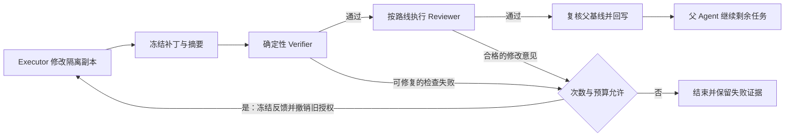

# 多 Agent 协作修复记录

范围是根目录 `minicode` 的当前运行时。保留已有角色入口及工作区内其他任务的改动。本轮基于此前评审确认的问题修复权限、证据传递、父子生命周期、并发提交、委派熔断，并新增有界实现修复。

## 变更

| 问题 | 修复后的行为 | 主要实现 |
| --- | --- | --- |
| Adjudicator 漏用只读隔离，且无法读取裁决证据 | 宿主校验角色和底层 agent 类型的封闭映射；裁决者服从 Assignment 的路径边界，只读取明确授权的冻结证据 | `minicode/tools/task.py`、`minicode/workflow_runner.py` |
| 写入路径不重叠，却因共同读取依赖而发生写偏差 | 在进程内及跨进程提交锁中复核完整父工作区基线，包括空补丁；另一候选修改过基线时，拒绝晋升旧验证结果 | `minicode/workflow_workspace.py`、`minicode/workflow_scope_registry.py` |
| 异步委派绕过同步失败熔断 | 同步和异步共享准入及一次性结果结算；排队任务启动前再查熔断；取消不计失败，迟到成功不能重开已熔断通道 | `minicode/tools/task.py` |
| 可修复的验证或审查失败立即终止 | 默认允许一次实现修复，宿主策略限定 0–2 次；共享原预算与截止时间；新轮次拥有新的 Assignment、补丁摘要、验证和审查证据 | `minicode/workflow_repair.py`、`minicode/central_scheduler.py`、`minicode/workflow_runner.py` |
| 修复循环可能混用前轮授权 | 恢复隔离工作副本时撤销旧补丁回写资格；保留原始基线与收窄后的执行授权；完整审计按修订回放，提交只能引用最后有效轮次的证据 | `minicode/workflow_workspace.py`、`minicode/scheduler_trace.py`、`minicode/scheduler_audit.py` |

## 修复循环边界

人工确认路线、权限或安全拒绝、基础设施故障、未知/不充分的验收证据不触发实现修复。修复不能扩大执行范围、修改原始验收约束，或复用旧补丁的验证通过记录。未改变补丁的修复不会再次验证后冒充成功。

完整失败历史保存在 durable audit 中。父任务输出受长度上限约束时可以显示最后有效轮次，并标记摘要已压缩；摘要不用于替代完整提交审计。

## 验证

多 Agent 相关的最终整组回归 **939 项通过，覆盖 49 个测试文件**（Python 3.12，`integration-command.json` / `integration-final.txt`）。修复循环与安全边界的独立复核已通过，未发现新的越权、错误提交或旧证据放行问题。

全仓验证没有达到全绿，记录如下：

| 执行范围 | 结果 | 说明 |
| --- | --- | --- |
| 全仓，Python 3.12 | 收集阶段 3 个错误 | 环境缺少 `jsonschema`，改用现有依赖齐全的 Python 3.13 |
| 全仓，Python 3.13，沙箱内 | 9,640 passed / 151 failed / 128 errors / 2 skipped | 很多 HTTP 夹具在 `socket.bind` 即被沙箱拒绝；见 `full-suite-python313.txt` |
| 上次未通过的 279 项，允许本地端口后重跑 | 257 passed / 22 failed | 精确重跑清单与 JUnit：`retry-nodes.txt`、`retry-results.xml`；见 `retry-outside-sandbox.txt` |

剩余失败的归因：

- 3 项 Skill 质量门：旧源码与当前源码输出相同，既有数据集哈希和 3 个 Skill 召回案例不符合冻结基线。Python 3.12/3.13 结果也相同。见 `quality-gate-diagnosis.md`。
- 15 项 Memory 发布认证：旧/当前源码均为相同的 15 失败、18 通过，既有未声明源码差异已先行阻断认证；本轮修复及并行工作也改变了部分受保护文件的哈希，因此不能声称原发布认证仍然有效。见 `memory-freeze-diagnosis.md`。
- 1 项 Intent 断言：并行 Skill 工作新增 `skill_selection_mode`，与旧测试严格比较的上下文字段不一致。
- 2 项 Skill 目录断言：当前 lint Skill 声明了 `debug.update`，而测试期望及示例只覆盖 `code.update`。原快照没有保存该目录，无法确定此目录差异出现的时间。后两类见 `skill-failures-diagnosis.json`。
- 1 项安装包内文件审批测试：实际审批与目标文件内容断言已通过；测试监测 `Path.write_text` 的调用次数，而原子写入实现使用 `os.fdopen` / `fsync` / `os.replace`，计数器漏掉了真实写入。详情见 `packaging-diagnosis.json`。

全仓运行期间，截断 diff 探测测试定稿为“不进入自动修复”的负例。重跑清单将该旧测试名映射到最终名称，原因保存在 `retry-scope.json`；最终 939 项整组验证也包含该定稿测试。以上是多次执行的记录，不包装成一次全仓通过。

真实修复前工作树快照及源哈希记录在 `baseline.json`。已完成的相同测试旧版失败、新版通过证明：`roles-proof.json`、`parent-proof.json`、`delegation-proof.json`、`write-skew-counterexample.json`。反例涵盖真实文件权限、真实冻结工作区和跨进程提交，不依赖人为制造的生产代码 mutant。

| 相同测试集 | 当前实现 | 真实修复前快照 | 证据 |
| --- | --- | --- | --- |
| 角色权限与证据通道 | 12 通过 | 9 失败、3 通过 | `roles-proof.json` |
| 父任务续跑及提交回执 | 12 通过 | 11 失败、1 通过 | `parent-proof.json` |
| 同步/异步委派熔断 | 19 通过 | 15 失败、4 通过 | `delegation-proof.json` |
| 并发读取依赖与晋升 | 17 通过 | 5 失败、12 通过 | `write-skew-counterexample.json` |
| 实际 workflow 首轮失败后修改并重新验证 | 2 通过 | 2 失败 | `implementation-repair-counterexample.json` |

上述测试集用于证明具体行为变化，不将各次重跑数量累计为测试总量。修复循环证明只选择真实运行旧工作流的两条用例，不把旧版不存在新 API 的异常视为功能反例。

目标实现和新增测试的 Ruff 检查通过。`tooling.py` 的既有 E731 getter lambda 在真实旧快照同样存在，本次未改变该行，比较记录见 `lint-tooling-existing.json`。相关文件的 `git diff --check` 通过。

## 已知取舍

- 完整父基线检查采用保守策略。即使两个候选最终可以安全合并，先提交者改变基线后也会令后提交者重新执行；在具备可靠的读取依赖集合之前，优先避免合并未经验证的结果。
- 本轮保持现有角色和模型路由，不合并 `explore`/`plan`，也未增加所有线程池统一的并发名额管理。
- 验证面是离线运行时、真实本地检查命令及对抗回归；不把这些结果解释为真实模型质量或速度提升的 benchmark。
- 工作区原有大量未提交修改，并有并行的 Skill 选择任务。本轮文件清单记录在 `owned-targets.json`；共享文件中的其他改动不归因于本次修复。
