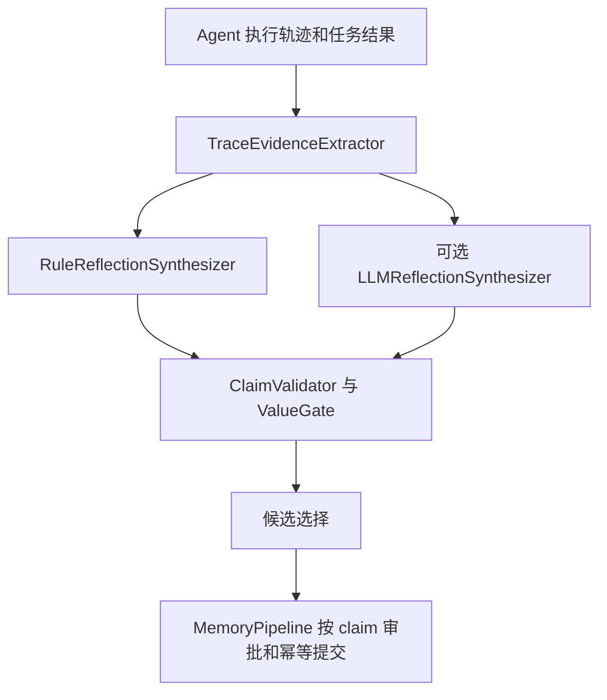

# 持久化记忆：错误恢复规则生成审查

日期：2026-09-09。审查对象为工作区当前 `minicode/`，包括已有未提交修改；未审查旧副本 `py-src/` / `ts-src/`。本次没有修改生产源码、调用真实模型或写入正式记忆。

## 结论

赞成用专职子 Agent 做恢复经验归纳。仓库已有 `LLMReflectionSynthesizer`，具备独立上下文、无工具、结构化候选输出、预算和超时控制，可以直接作为基础。真正需要改的是三个边界：**保留足够的原始证据；允许经验正文做语义抽象；把验证关系检查统一放在候选准入处。**

当前生成器主要做格式归纳：抽共同词、删路径、拼固定句式。它没有充分理解“失败条件—行为变化—验证范围”。但只替换生成器也无法解决问题：上游已经丢失部分输入或误关联恢复，下游又要求复述原句。

建议首版只接管错误恢复经验，按独立恢复片段生成与选择；复用现有 `MemoryPipeline` 提交。项目约束、用户纠正等独立记忆继续保留现有处理。

## 当前调用链



- 生产入口：[agent_loop.py:5073](</Users/zhourunbo/code/coding agent/MiniCode-Python-main/minicode/agent_loop.py:5073>) → `CyberneticOrchestrator.reflect_on_task` → [memory_pipeline.py:1998](</Users/zhourunbo/code/coding agent/MiniCode-Python-main/minicode/memory_pipeline.py:1998>)。
- 核心生成器：[agent_reflection.py:356](</Users/zhourunbo/code/coding agent/MiniCode-Python-main/minicode/agent_reflection.py:356>)、[reflection_synthesis.py:946](</Users/zhourunbo/code/coding agent/MiniCode-Python-main/minicode/reflection_synthesis.py:946>)。
- 生产配置通过 `ReflectionLLMConfig.from_runtime()`，无覆盖时默认 `llm_shadow`，正式记忆仍使用规则结果；直接 `ReflectionEngine()` 默认 `rule`。本次没有读取用户实际运行配置，不能推断某个已运行会话启用了哪种模式。[cybernetic_orchestrator.py:154](</Users/zhourunbo/code/coding agent/MiniCode-Python-main/minicode/cybernetic_orchestrator.py:154>)、[reflection_llm.py:123](</Users/zhourunbo/code/coding agent/MiniCode-Python-main/minicode/reflection_llm.py:123>)。

## 优先修正的问题

### 1. 不同测试目标会被归并成一次 confirmed 恢复

已复现：

```text
pytest + args=[tests/test_auth.py] 失败
→ 编辑 docs/README.md
→ pytest + args=[tests/test_billing.py] 成功
→ 生成 confirmed recovery，进入 structured_claims
```

`_call_target()` 只从 `command` 提取目标，忽略独立的 `args` 和 `cwd`，所以两次目标都成了 `pytest`。后续根据同目标和中间文件变更生成 confirmed 恢复，原 auth 测试没有重跑。当前 `run_command` schema 支持 `args`，这不是只存在于旧日志的输入形式。

位置：[reflection_evidence.py:2192](</Users/zhourunbo/code/coding agent/MiniCode-Python-main/minicode/reflection_evidence.py:2192>)、[reflection_evidence.py:1506](</Users/zhourunbo/code/coding agent/MiniCode-Python-main/minicode/reflection_evidence.py:1506>)。

另一个分支存在相同类别的问题：`backend/tests/test_config.py` 失败，随后 `frontend/tests/test_config.py` 成功，无代码编辑也会被写成“使用修正后的测试调用”。资源指纹保留 basename，任意交集就当成同目标。

位置：[reflection_evidence.py:2159](</Users/zhourunbo/code/coding agent/MiniCode-Python-main/minicode/reflection_evidence.py:2159>)、[reflection_evidence.py:1918](</Users/zhourunbo/code/coding agent/MiniCode-Python-main/minicode/reflection_evidence.py:1918>)。

建议：保存规范化调用对象及完整工作区相对目标；命令、参数、cwd、测试选择范围均需参与关系判断。启发式相似只能提出候选关系，不能直接授予 confirmed。中间有编辑只证明发生过变更，不证明该变更修好了目标。

### 2. 工具成功不等于验证通过

已复现：shell pipeline 返回成功，输出 `1 passed, 1 error in 0.15s`，会被当成 passed，并支持 confirmed recovery。当前解析器否定部分 `failed` 和零测试输出，随后匹配 `passed`；未覆盖混合 error。

位置：[reflection_evidence.py:2519](</Users/zhourunbo/code/coding agent/MiniCode-Python-main/minicode/reflection_evidence.py:2519>)。

建议：区分进程状态与测试/检查结果，尽可能使用工具的结构化验证数据。文本推断无法识别或有矛盾时保留 unknown，不用进程零退出覆盖测试错误。

### 3. 原句包含检查同时限制泛化，又放过无依据的推广

Recovery 正文必须包含原恢复动作，或规则生成的去路径摘要；还必须包含原错误全文或抽出的错误行。这个检查是字面包含，不是对正文每个结论的语义支持判断。

位置：[reflection_synthesis.py:1471](</Users/zhourunbo/code/coding agent/MiniCode-Python-main/minicode/reflection_synthesis.py:1471>)、[reflection_synthesis.py:1519](</Users/zhourunbo/code/coding agent/MiniCode-Python-main/minicode/reflection_synthesis.py:1519>)。

离线候选探针结果：

| 候选 | validator | value gate |
|---|---|---|
| 原错误 + 原恢复动作 | 通过 | 接受 |
| 同一个事实的语义等价改写 | 拒绝：claim_statement_not_grounded | 拒绝 |
| 原句后追加“还能解决所有分布式数据库的时钟同步缺陷” | 通过 | 接受 |
| 原句绑定无关的 logging 测试通过 | 通过 | 接受 |

最后一项暴露另一条不一致：共享 validator 只检查引用的 verification 是否 passed；规则生成器内部另有验证先后和相关性检查。同一证据交给规则生成器时得到 inferred、无 verification IDs，而直接构造 LLM 候选可被接受为 confirmed。

位置：[reflection_synthesis.py:1449](</Users/zhourunbo/code/coding agent/MiniCode-Python-main/minicode/reflection_synthesis.py:1449>)；规则内部检查在 [reflection_synthesis.py:1029](</Users/zhourunbo/code/coding agent/MiniCode-Python-main/minicode/reflection_synthesis.py:1029>)。

建议：先把证据关系、顺序、验证对象与范围的检查移到统一准入处，并修正其中的弱匹配逻辑，供规则和模型共同使用。再拆开“可逐字核验的来源摘录”和“允许抽象的经验正文”。ID 和摘录正确仍不能证明新增正文受到支持；语义审查需检查每项结论及适用范围，不应把模型自报 confidence 当成证据。

## 为什么仅打开 LLM 开关不够

1. `llm + gap_fill` 按整任务决策，只要规则有任何可持久化 claim，就完全跳过模型。它无法改善一条已经通过但泛化很弱的恢复经验，也会被同任务无关约束挡住。[agent_reflection.py:388](</Users/zhourunbo/code/coding agent/MiniCode-Python-main/minicode/agent_reflection.py:388>)。
2. `replace` 是整批替换；记录了 rule regression 也不会自动阻止较弱结果替换较强结果。应按恢复片段选择，保留已验证操作与其他独立 claim。[agent_reflection.py:422](</Users/zhourunbo/code/coding agent/MiniCode-Python-main/minicode/agent_reflection.py:422>)、[tests/test_reflection_llm_modes.py:264](</Users/zhourunbo/code/coding agent/MiniCode-Python-main/tests/test_reflection_llm_modes.py:264>)。
3. `TaskEvidence.ToolEvidence` 不保存调用参数。LLM 看到的是抽取后的证据，无法完整重审规则漏掉的动作变化。例如同一调用把 `timeout=1` 调成 `120` 后成功，现有流程没有 recovery 候选。这个案例不应自动上升为因果结论，但应保留给学习器分析。[reflection_evidence.py:599](</Users/zhourunbo/code/coding agent/MiniCode-Python-main/minicode/reflection_evidence.py:599>)。
4. 当前所谓 generalized pattern 依赖共同英文词、去文件路径、固定句式。这能改善文字检索，却不足以推导行为机制或跨工具适用条件。[reflection_synthesis.py:406](</Users/zhourunbo/code/coding agent/MiniCode-Python-main/minicode/reflection_synthesis.py:406>)、[reflection_synthesis.py:452](</Users/zhourunbo/code/coding agent/MiniCode-Python-main/minicode/reflection_synthesis.py:452>)。

## 专职 RecoveryLessonAgent 的具体设计

以下名称与字段是建议，当前尚未实现。

```text
带 event/call ID 的有界执行证据片段
→ RecoveryLessonAgent（复用 LLMReflectionSynthesizer）
→ 经验候选 + 来源摘录 + 适用范围 + 不确定项
→ 统一事实/验证关系检查 + 语义支持审查
→ 按恢复片段选择、去重和 value gate
→ MemoryPipeline 幂等提交
```

**输入保留事实，关系允许存疑。** 每个片段包含失败调用的工具、参数、cwd、状态、输出；后续相关调用与差异；有界 diff 片段；验证目标、结果和时间；项目/run/事件身份。原始日志视为数据，继续脱敏、限量。上游可以提出可能相关的片段，不提前把弱匹配盖章为“已验证修复”。

**Agent 负责语义。** 判断问题是否相同、哪些行为发生实质变化、值得复用的操作是什么、适用范围是什么、证据不足时应否放弃。输出允许为空；一次观察到恢复，与证实根因或跨项目普适规律，分别表达。

| 候选内容 | 职责 |
|---|---|
| `source_event_ids`、`evidence_quotes`、`verification_ids` | 精确关联与核验来源 |
| `trigger`、`action`、`applies_when` | 提炼可执行经验与适用条件 |
| `observed_result`、`verification_scope` | 明确实际观察到什么 |
| `hypothesis`、`limitations` | 显示推测和未验证边界 |
| `abstain_reason` | 证据不足时不生成规则 |

这些字段可映射或扩展现有 `ReflectionClaim`；不必先更换整个记忆存储。原始调用和文件仍留在证据中，经验正文不被迫复制机器路径。

**确定性代码负责事实边界和存储。** 检查证据 ID、事件顺序、真实执行状态、可验证的目标身份与范围、schema、输出大小、作用域、幂等与审批；语义关系不明时不升级状态。模型没有直接 MemoryManager，不生成项目事实权限，不自行重新执行修复。

已有 [reflection_llm.py:1518](</Users/zhourunbo/code/coding agent/MiniCode-Python-main/minicode/reflection_llm.py:1518>) 和 [reflection_llm.py:1044](</Users/zhourunbo/code/coding agent/MiniCode-Python-main/minicode/reflection_llm.py:1044>) 可复用。首版可继续单次有界调用，沿用现有预算、取消和超时。若确实需要查更多证据，后续再增加受事件身份限制的只读读取工具。

## 调度与回退

首版建议仍在现有任务结束后的反思阶段运行，模型生成保持在最终 memory 提交锁外。调用失败可以保留可靠的具体事件记录；证据本身不成立时返回不学习，避免回退到已经误判的 confirmed 规则。非恢复类可靠 claim 无需被整批丢弃。

通用 `task` 子 Agent 默认会创建项目 MemoryManager，并有自动反思写回路径；拿来分析记忆需要额外切断递归学习，专用无工具调用更直接。[tools/task.py:2425](</Users/zhourunbo/code/coding agent/MiniCode-Python-main/minicode/tools/task.py:2425>)。

若未来要求“先回复用户，后台继续学习”，应另做持久化证据队列、任务领取、独立预算、结果重放和幂等提交。现有异步子 Agent 生命周期属于当前回合，父任务结束会取消未完成任务，不是现成的后台学习服务。[subagent_lifecycle.py:238](</Users/zhourunbo/code/coding agent/MiniCode-Python-main/minicode/subagent_lifecycle.py:238>)。后台提交还需要接收已生成候选的 Pipeline 接口，以免重入 `write_result()` 再生成一次。

`MemoryCuratorAgent` 负责已有记忆整理，保持职责独立。`recovery_control.py` 负责本轮重试熔断和拒绝去重，也不属于这次经验生成替换范围。

## 建议实施顺序与验收

1. 修正误关联、混合验证结果及共享 validator 的关系缺口；把本次反例固化为回归用例。
2. 建立保留调用参数和 diff 的有界证据输入；将来源摘录与经验正文分开。
3. 复用 LLMReflectionSynthesizer，按恢复片段生成与选择；保留独立约束和已验证操作。
4. 在 shadow 对照中测量错误经验接受率、有效经验召回率和适用范围；达标后仅切换恢复经验路径。具体数值门槛应在固定评测集后确定。

泛化验收需要路径/工具改名、等价命令包装、多语言表述、不同输出格式、多错误交错、无关测试通过、偶发重试、未验证修复等独立样本。还应做跨任务验证：生成的经验是否能让后续相关任务减少重复试错，又不会误导不相关任务。仅通过现有 validator 或匹配生成文本，无法证明泛化有收益。

## 本次验证及边界

- 7 个相关测试模块：**128 passed in 1.79s**。
- [evidence_probe.py](</Users/zhourunbo/code/coding agent/MiniCode-Python-main/artifacts/recovery-rule-review-2026-09-09/evidence_probe.py>) 使用当前工具参数校验器、真实 trace emitter 和合成 ToolResult；三项误判、一项输入变化漏记。输出：[evidence_probe.json](</Users/zhourunbo/code/coding agent/MiniCode-Python-main/artifacts/recovery-rule-review-2026-09-09/evidence_probe.json>)。
- [synthesis_probe.py](</Users/zhourunbo/code/coding agent/MiniCode-Python-main/artifacts/recovery-rule-review-2026-09-09/synthesis_probe.py>) 使用合成 TaskEvidence 测试候选准入；结果见上表。输出：[synthesis_probe.json](</Users/zhourunbo/code/coding agent/MiniCode-Python-main/artifacts/recovery-rule-review-2026-09-09/synthesis_probe.json>)。
- 两个探针均已在本地重跑。这里“可持久化”指通过反思器/validator/value gate；未调用正式持久化流程，不能据此声称已经污染用户的正式记忆。
- 未进行真实 LLM 对照，本报告证明当前限制和误判，不宣称新方案已取得泛化提升。

复现命令（工作区根目录执行）：

```bash
.venv-acceptance/bin/python -m pytest -q tests/test_reflection_synthesis.py tests/test_reflection_llm_modes.py tests/test_reflection_derived_recovery.py tests/test_reflection_operational_recovery.py tests/test_reflection_generic_tool_recovery.py tests/test_reflection_tool_semantics.py tests/test_reflection_persistence_authority.py
.venv-acceptance/bin/python -B artifacts/recovery-rule-review-2026-09-09/evidence_probe.py
PYTHONPATH=. .venv-acceptance/bin/python -B artifacts/recovery-rule-review-2026-09-09/synthesis_probe.py
```
