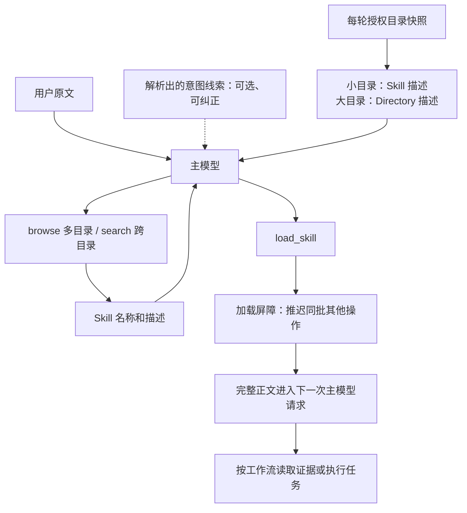

# Skill 发现与注入链路验收（2026-09-08）

本轮已完成实现、回归、真实模型执行与逐题复核。默认采用主模型选择 Skill：小目录展示完整描述，大目录展示 Directory 描述并让主模型按需展开。新 Skill 依靠目录元数据进入发现流程，不需要新增按 Skill 名称编码的路由规则。

## 结果

在固定的 **20 个只读任务、1,000 个测试 Skill** 上，使用当前配置模型 `glm-5.3-flash`：

| 指标 | 开发集 | 首次留出集 | 合计 |
|---|---:|---:|---:|
| 所需 Skill 全部正确加载、无额外错载 | 7/7 | 8/8 | **15/15** |
| 所需完整正文进入后续已完成模型请求 | 7/7 | 8/8 | **15/15** |
| 负例未加载或观察到旁路读取正文 | 3/3 | 2/2 | **5/5** |
| 按正文要求在加载后读证据、遵守阶段顺序 | 7/7 | 6/8 | **13/15** |
| 原始严格格式/关键词与步骤协议通过 | 4/7 | 5/8 | **9/15** |
| 核心任务完成（代理逐条复核，含负例） | 8/10 | 10/10 | **18/20** |
| 完整答案严格语义通过（代理复核，含负例） | 6/10 | 7/10 | **13/20** |

20 次正式执行均完成，无基础设施错误或超时，不需要剔除失败样本。另有一次网络受限的 smoke DNS 失败和一次联网成功的平铺目录 smoke，均单独保留，不并入上表。模型请求快照、工具执行、正文 digest 和后续请求证据保存在每题原始记录中。

这里的 15/15 说明本批的检索注入成功，不能解释为任意真实编程任务都能稳定达到 90%。任务是合成项目上的只读诊断/解释；目录包含 15 个实质工作流和 985 个固定干扰技能，包含相近业务域、同名技能和同目录相邻操作。真实项目的技能质量、描述重叠和任务分布可能不同。留出集在运行前冻结，但由本次协作作者编写，并非作者完全未见的外部测试集。

## 当前链路与配置

当前 `load_runtime_config` 已验证为 `skillSelection.mode=model`，平铺预算 8000 字符、描述页预算 4000 字符。`intentHints=false`、`intentPrefetch=false`；意图解析继续保留显式指令和约束处理，默认不以解析出的候选分数限制模型可见 Skill。旧 `routed` 可显式选择回退。未改写用户全局配置文件；默认值在代码中生效，显式设置仍优先。

意图线索对照使用同一冻结开发集再跑 10 次：正确加载仍为 **7/7**，负例未触发仍为 **3/3**，没有观察到命中率提高。总模型调用从 52 到 48；每题耗时中位数从 75.22 秒到 71.37 秒，仅一次配对实验，不能认定稳定加速。原协议格式通过为 6/7，完整语义未逐题复核，不能据此声称答案质量提高。当前保留提示开关默认关闭，预取仍是可选实验。

## 已完成的修复

- **发现分页**：搜索覆盖完整候选序列，优先目录和全局结果交错分页，`limit=1` 仍可到达全局候选，改变页大小不丢尾部结果。
- **上下文预算**：浏览、搜索和可选意图预取复用同一描述分页器；标题、截断说明、分页指引计入预算。超长描述明确缩短，保留完整加载名称和加载正文。
- **会话刷新**：CLI/TUI 在下一用户轮次统一刷新目录及三个 Skill 工具，保留普通工具和 MCP 连接。变更/删除后的旧正文失效，保留历史工具调用与结果配对；共享 Conversation runtime 使用已绑定快照清理旧正文，不重复扫描。
- **加载健壮性**：`load_skill` 输入为列表、字符串、数字时走正常工具校验错误并允许模型纠正，不再使整轮崩溃；同批其他动作仍被屏障延后。
- **提示与配置**：主模型选择成为默认；提示说明当前任务阶段、条件证据与最小够用技能集合。意图线索明确为可能错误、非完整且无序的派生信息，用户原文具有优先权。
- **元数据契约**：补齐 lint 技能现有 `debug.update` 能力的自然语言示例和测试，不增加 Skill 专属解析规则。

实现说明见 [Skill 路由文档](</Users/zhourunbo/code/coding agent/MiniCode-Python-main/docs/skill-routing-v3.md>)；本轮相对开始时工作区的 Python [变更清单](</Users/zhourunbo/code/coding agent/MiniCode-Python-main/artifacts/skill-chain-completion-2026-09-08/changes.json>)单独记录。原有大量工作区变更保留，没有提交或推送。

## 验证与反证

- 大范围相关回归：首次 **1008 通过、1 个既有元数据覆盖缺口**。补齐该例后，包含该项及受影响路由/契约/衍生评分器的定向复测 **184 项全部通过**。
- CLI/TUI/网关生命周期：**26 项通过**，网关仅绑定本机临时端口。
- 新评分器：**22 项通过**；证实原关键词评分会把反向结论、负例错误回答当作成功，衍生评分将未复核语义标为未知，并记录正文旁路读取。
- 反证：新增发现工具 12 项、预取 9 项、目录刷新 5 项、畸形加载参数 3 项、共享 runtime 旧正文 1 项均在旧实现复现失败；刷新另有 2 个不变正文控制组在旧实现也通过。
- 本轮检查文件 Ruff 无新增问题；`tooling.py` 保留本轮开始前即存在的 E731，无关行未改动。

证据位于 [skill-chain-completion-2026-09-08](</Users/zhourunbo/code/coding agent/MiniCode-Python-main/.repair-work/skill-chain-completion-2026-09-08>)：`broad-tests.log`、`final-targeted-tests.log`、`lifecycle-tests.log`、各 `*-counterexample.json` / 修复说明。每个正式批次均保存全部生产及 evaluator Python 文件 hash，批次内一致；冻结任务与分组未因结果重标、删除或挑选重跑。

## 剩余偏差如何解释

**C08/C15 的正文步骤遵循存在偏差。** 模型先读了所需证据，之后正确加载并收到正文，但没有依照 Skill 明确要求再次读取；C15 在已有证据后同批加载两阶段 Skill。两题记为严格步骤失败，不能改称检索失败，也不追改冻结流程要求。

**格式评分与正确性分开。** C03 用 `48,000` 表示 `48000`，C06/C09 将报告标题译成中文，会被原始格式/关键词检查判失败。原分数仍保留；语义复核允许数字分隔符和准确翻译，也独立检查推荐是否有证据支持。

**完整答案仍有无依据的推断。** 例如 C01/C11 将 ledger + outbox 方案扩展为无充分条件的外部副作用恰好一次保证；C02 将两份未建立关联的 HTTP/checkout 记录串成同一调用；C03 从 Seq Scan 直接断定没有任何索引；C13 提出的超时/重试数值缺乏观测支持；C08 对合成凭据和指纹做过强推断；C15 将建议验证字段解释成已执行的验证结果。这些是答案或工作流执行质量问题，不能靠增加前置 Skill 路由规则来证明解决。

语义分来自两个子代理逐题阅读原文、最终回答及证据后的独立复核，根代理抽查了关键失败；**不是人工标注金标准，也不是确定性真值**。逐项严重度、判断依据和 C11 的中等置信度保留在 [语义复核记录](</Users/zhourunbo/code/coding agent/MiniCode-Python-main/artifacts/skill-chain-completion-2026-09-08/semantic-reviews.json>)。没有把关键词命中当作结论正确。

## 默认配置的逐题结果

| 任务 | 加载结果 | 正文步骤遵循 | 完整答案严格语义 |
|---|---|---|---|
| [C01](</Users/zhourunbo/code/coding agent/MiniCode-Python-main/.repair-work/skill-chain-completion-2026-09-08/eval/live-dev-large-01/chunk-0/C01/run.json>) | queue/idempotency | 通过 | 存在重要错误/无依据扩展 |
| [C02](</Users/zhourunbo/code/coding agent/MiniCode-Python-main/.repair-work/skill-chain-completion-2026-09-08/eval/live-dev-large-01/chunk-1/C02/run.json>) | http/retry-budget | 通过 | 存在重要错误/无依据扩展 |
| [C03](</Users/zhourunbo/code/coding agent/MiniCode-Python-main/.repair-work/skill-chain-completion-2026-09-08/eval/live-dev-large-01/chunk-2/C03/run.json>) | database/query-plan | 通过 | 存在重要错误/无依据扩展 |
| [C04](</Users/zhourunbo/code/coding agent/MiniCode-Python-main/.repair-work/skill-chain-completion-2026-09-08/eval/live-holdout-large-01/chunk-0/C04/run.json>) | cache/expiry-analysis | 通过 | 通过 |
| [C05](</Users/zhourunbo/code/coding agent/MiniCode-Python-main/.repair-work/skill-chain-completion-2026-09-08/eval/live-holdout-large-01/chunk-1/C05/run.json>) | auth/access-audit | 通过 | 通过 |
| [C06](</Users/zhourunbo/code/coding agent/MiniCode-Python-main/.repair-work/skill-chain-completion-2026-09-08/eval/live-dev-large-01/chunk-3/C06/run.json>) | config/precedence | 通过 | 通过 |
| [C07](</Users/zhourunbo/code/coding agent/MiniCode-Python-main/.repair-work/skill-chain-completion-2026-09-08/eval/live-holdout-large-01/chunk-2/C07/run.json>) | architecture/import-cycle | 通过 | 通过 |
| [C08](</Users/zhourunbo/code/coding agent/MiniCode-Python-main/.repair-work/skill-chain-completion-2026-09-08/eval/live-holdout-large-01/chunk-3/C08/run.json>) | logging/redaction | 未加载后重读证据 | 存在重要错误/无依据扩展 |
| [C09](</Users/zhourunbo/code/coding agent/MiniCode-Python-main/.repair-work/skill-chain-completion-2026-09-08/eval/live-dev-large-01/chunk-0/C09/run.json>) | api/error-contract | 通过 | 通过 |
| [C10](</Users/zhourunbo/code/coding agent/MiniCode-Python-main/.repair-work/skill-chain-completion-2026-09-08/eval/live-holdout-large-01/chunk-0/C10/run.json>) | docs/startup-guide | 通过 | 通过 |
| [C11](</Users/zhourunbo/code/coding agent/MiniCode-Python-main/.repair-work/skill-chain-completion-2026-09-08/eval/live-holdout-large-01/chunk-1/C11/run.json>) | queue/idempotency | 通过 | 存在重要错误/无依据扩展 |
| [C12](</Users/zhourunbo/code/coding agent/MiniCode-Python-main/.repair-work/skill-chain-completion-2026-09-08/eval/live-dev-large-01/chunk-1/C12/run.json>) | ci/pipeline-diagnosis、ci/test-isolation | 通过 | 通过 |
| [C13](</Users/zhourunbo/code/coding agent/MiniCode-Python-main/.repair-work/skill-chain-completion-2026-09-08/eval/live-dev-large-01/chunk-2/C13/run.json>) | checkout/latency-diagnosis、checkout/provider-resilience | 通过 | 存在重要错误/无依据扩展 |
| [C14](</Users/zhourunbo/code/coding agent/MiniCode-Python-main/.repair-work/skill-chain-completion-2026-09-08/eval/live-holdout-large-01/chunk-2/C14/run.json>) | checkout/latency-diagnosis | 通过 | 通过 |
| [C15](</Users/zhourunbo/code/coding agent/MiniCode-Python-main/.repair-work/skill-chain-completion-2026-09-08/eval/live-holdout-large-01/chunk-3/C15/run.json>) | ci/pipeline-diagnosis、ci/test-isolation | 未加载后重读证据；同批加载两阶段 | 存在重要错误/无依据扩展 |
| [C16](</Users/zhourunbo/code/coding agent/MiniCode-Python-main/.repair-work/skill-chain-completion-2026-09-08/eval/live-dev-large-01/chunk-3/C16/run.json>) | 不加载（符合） | — | 通过 |
| [C17](</Users/zhourunbo/code/coding agent/MiniCode-Python-main/.repair-work/skill-chain-completion-2026-09-08/eval/live-dev-large-01/chunk-0/C17/run.json>) | 不加载（符合） | — | 通过 |
| [C18](</Users/zhourunbo/code/coding agent/MiniCode-Python-main/.repair-work/skill-chain-completion-2026-09-08/eval/live-holdout-large-01/chunk-0/C18/run.json>) | 不加载（符合） | — | 通过 |
| [C19](</Users/zhourunbo/code/coding agent/MiniCode-Python-main/.repair-work/skill-chain-completion-2026-09-08/eval/live-holdout-large-01/chunk-1/C19/run.json>) | 不加载（符合） | — | 通过 |
| [C20](</Users/zhourunbo/code/coding agent/MiniCode-Python-main/.repair-work/skill-chain-completion-2026-09-08/eval/live-dev-large-01/chunk-1/C20/run.json>) | 不加载（符合） | — | 通过 |

[完整衍生结果](</Users/zhourunbo/code/coding agent/MiniCode-Python-main/artifacts/skill-chain-completion-2026-09-08/results.json>)包括 20 题主实验、10 题意图线索对照、原记录 hash 与正文暴露检查。评分器与冻结判据：[score_v2.py](</Users/zhourunbo/code/coding agent/MiniCode-Python-main/.repair-work/skill-chain-completion-2026-09-08/score_v2.py>)、[outcome-rubric.md](</Users/zhourunbo/code/coding agent/MiniCode-Python-main/.repair-work/skill-chain-completion-2026-09-08/outcome-rubric.md>)。复现命令及隔离范围见 [评测器说明](</Users/zhourunbo/code/coding agent/MiniCode-Python-main/.repair-work/skill-chain-completion-2026-09-08/eval/README.md>)。
