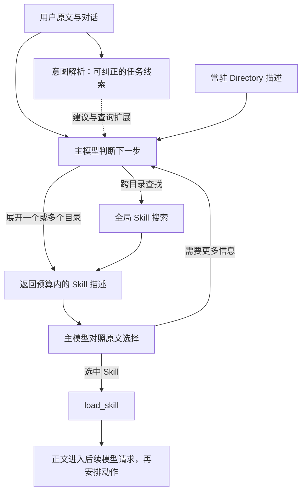

# 分层 Skill 发现与意图解析复用

状态：设计修订，未修改生产实现。日期：2026-09-08。

本方案扩展 [小目录全描述方案](skill-model-first-proposal.md)：根据目录的实际上下文占用选择平铺或分层，保持主模型作语义决策。千级 Skill 采用 Directory 描述常驻、按需展开 Skill 描述、按需加载正文。意图解析作为可纠正的任务线索继续使用。

## 推荐职责

| 模块 | 职责 |
| --- | --- |
| 意图解析 | 从原文与上下文提取目标、对象、肯否定、操作顺序和证据；提供可忽略／纠正的查询扩展与目录建议 |
| Directory 目录 | 表达可用能力范围，为模型提供导航；不决定读取权限 |
| 检索与分页 | 在明确 token 预算内返回 Skill 描述，保留全局搜索和继续展开的能力 |
| 主模型 | 对照原始请求决定看哪些目录、修正任务理解、选择零个或多个 Skill |
| loader／执行器 | 精确身份与版本校验、实际权限、正文交接及加载后再决策的顺序 |

应退休的是“意图解析决定哪些能力存在”的职责。不能为了保住先前投入，要求每次选择必须服从解析结果；也不应因选择方式改变而删除已有的目标、证据和上下文处理。

## 为什么仍有意图解析的价值

当前代码可核验：

- `ParsedIntent` 已有原始请求、实体、复杂度、按序 `operations`、肯否定、confidence、原文 span、证据来源与有限对话上下文。`to_detailed_dict()` 能保留详细信息；旧 `to_dict()` 仅保留旧标量字段，不能拿它充当完整任务线索。
- 在启用 work chain 的路径中，`agent_loop.py` 用它构建 `TaskObject`，提取相关文件、任务信息；FeedforwardController 读取意图、复杂度、实体进行资源预配置，并可能影响步数预算；context_cybernetics 也接收其意图信号。
- pipeline／verification 代码有消费者，但不能把现有接线夸大成所有普通任务都已完成调度和验证；本轮未查到 memory 或 central_scheduler 直接消费 ParsedIntent 的证据。

新 Skill 发现流程可以复用它做三件具体事情：

1. **组织任务线索。** 把“先定位性能瓶颈，满足条件后重构；接口保持不变”分成建议阶段及原文约束线索，减少查询里背景动作与真正要求混杂的问题。操作顺序不是已经证明的完整依赖图，模型必须核对原文。
2. **扩展检索和预取。** 用实体、阶段短语、上下文指代生成额外查询，或低成本预取少量目录描述。始终保留原始请求查询；错误归类不能覆盖原文、关闭搜索或排除其他目录。
3. **资源和质量观测。** 延续已有资源预配置，记录“模型采用／修正了哪些建议、少走几次目录浏览、是否改善选择”。复杂度和置信度是预测信息，不能当绝对事实或直接扩权。

任务线索优先带简短原文证据和来源，模型可见原始用户消息。UNKNOWN、缺字段、低置信度或解析超时都允许继续目录发现。已有解析器自带的 confidence 不等于校准后的正确率；在证明预取有效前，不设某个随意阈值就把目录锁死。

## 流程



模型读取 Directory 卡片后可以直接批量展开多个目录，不强制只选一个。它也可以无需 Skill，或在已知完整 Skill id 时直接请求加载。目录没有合适项时，全局搜索使用全部已授权 Skill 描述；模型不用先猜中正确 Directory。

Directory 卡片包含稳定 id、名称、能力描述、子项数量和版本。叶子 Skill 描述返回稳定 id、名称、适用描述及来源目录；正文仍不提前注入。根层未分目录的 Skill 也必须有可发现入口，不能因缺少 SKILL_DIR.md 就从导航消失。

## 防止分层放大误差

仅“选一个目录 → 只在该目录找”会重现旧问题，至少需要以下机制：

- **多目录选择**：调试／测试、性能／数据库、代码理解／文档本来就有交叉。物理存放目录不是互斥意图类别；可用目录交叉引用解决多归属，正文仍只有一个 canonical id。
- **独立的全局召回**：需要检索时，以原始请求对全局 Skill 描述执行语义／词面搜索。目录内候选与少量跨目录候选分别保留名额并合并展示，避免目录内分数把全局候选全部挤掉。这条查询不依赖意图分类成功，也不要求候选先命中旧 operation 表。
- **展开和搜索可继续**：每次返回 `has_more`、cursor、搜索范围及截断说明；模型可换目录、翻页、改写查询或全局搜索。当前页无匹配不等于目录里没有匹配。
- **目录更新可追踪**：新增 Skill 自动登记并更新数量／版本；Directory 的描述必须覆盖其子能力。可从 Skill 元数据生成覆盖清单，必要时维护摘要，但摘要不能成为唯一发现渠道。摘要过时或新能力归类不准时，全局索引仍能发现它。
- **检索视图不等于授权**：展开的目录及当前候选只控制本次返回哪些描述。任何当前主体有权读取的已知合法 Skill 都可请求加载；实际身份、版本、父级权限和用户结构化禁用继续校验。

向量检索和词面检索在这里负责降低千级目录的展示成本，不再执行“没有肯定意图就不能召回”的前置规则。它们仍可能漏检，所以必须配合多目录、分页与模型继续搜索，而不是宣称一个 top K 可以保证找到所有适用项。

## 工具 Interface 与上下文预算

概念 Interface 可收敛为：

```text
browse_skill_directory(directory_ids, cursor?)
  -> child_directories / skill_descriptions, has_more, snapshot_id

search_skills(query, directory_ids?, cursor?)
  -> bounded skill_descriptions + global_candidates, has_more, snapshot_id

load_skill(skill_id)
  -> exact full instructions + identity/version evidence
```

`search_skills` 的 directory_ids 是本次偏好或局部查询范围，系统仍保留独立全局候选和无目录限制调用。服务器执行固定的最大 token／字节预算，不接受模型用无限 limit 绕过限制。

小目录总描述能放入预算时，直接全量显示，避免为当前 17 个 Skill 多加一轮导航。总描述超预算时常驻 Directory 卡片，模型按需展开；切换依据是实际 token 预算，而非武断地按某个 Skill 数量切换。单个目录本身过大时分页；根层目录也过大时才增加摘要层或使用根搜索，不急于把所有项目强制组织成多层树。

可以从“目录段约 1–2k token、每批 Skill 描述约 2–4k token”作为待测预算起点，但这只是实验参数，需按模型和任务验证，不是已证明的最优配置。

千级模式中不能在 `load_skill` 的 schema enum 又塞入全部 Skill 名称，那会绕过目录分层的节省。使用固定 string id 参数，由服务器按完整授权 catalog 校验；返回的描述给模型精确 id。全量 enum 仅适合小目录，并非大规模硬性要求。

本项目当前有 11 个 Directory、17 个 Skill，Directory 卡片约 990 字符，另有 1 个未分目录的直接 Skill。当前发现逻辑支持一层 `directory/skill`，不是任意深度树。千级升级还要解决现有 128 binding 上限、全量元数据常驻服务端、稳定分页与版本快照；不能只改 prompt 后宣称支持上千个。

目录、全局索引、loader 和当前视图必须使用一致快照，新文件在 turn 边界刷新。恢复会话与上下文压缩后常驻目录入口仍在；选中正文的复用和新正文加载批次屏障沿用小目录方案。

## 一个例子

用户：导入两万条记录很慢，先找瓶颈，如果是转换逻辑造成的，再整理代码，保持接口不变。

- 解析器提供可能的两个阶段、数据导入对象、“保持接口不变”的原文证据。
- 主模型对照原文，优先查看 performance，并为后续阶段保留 refactoring；不是立刻执行两套工作流。
- 如果新装的批量导入分析 Skill 放在 data-engineering，原始请求的全局搜索仍有机会把它带回来，模型不必预先知道该目录或新增领域枚举。
- 即便解析器错标成 debug，其他 Directory 仍可见，全局请求仍以原文为基础，主模型可改正。
- 找到合适 Skill 才加载正文；完成测量后再决定是否需要重构 Skill。

这让已有解析承担信息整理和减少探索成本的作用，同时让新增能力由描述和索引进入系统。

## 用实验决定保留多少解析工作

比较三组，保持同一模型、同一原文／对话／catalog、同一总预算和任务操作边界：

A. Directory 分层＋主模型，完全不给意图提示。
B. 同样分层＋意图的可纠正提示／查询扩展，始终保留原始查询；解析的延迟、token 和预取成本全部计入。
C. 原有硬规则先筛选的方案作为基线。

首先单独比较 B 的任务提示，再测预取，避免把多项改动的收益混在一起。意图语义兜底若会增加一次 LLM 调用，也要作为独立开关比较，不能让它阻塞 Directory 发现或藏在成本之外。

使用已有 20 题作回归，加入实现冻结后独立编写的新 Skill／新任务，并在 100、1000、更多 Skill 的目录中加入真实可混淆的干扰项。还要故意提供错误意图标签、错误目录归属和过时目录摘要，检查模型是否能经其他目录／全局搜索纠正。

分别记录：目标目录是否可达、候选覆盖、最终正确加载、跨目录补救率、负例误触发、正文交接、浏览次数、端到端延迟和 token；超时与未找到要分开。只有 B 比 A 在准确率或成本上带来可重复收益，才保留该解析辅助；若某字段使模型更偏、不省成本，就停止把它用于 Skill 发现，其他消费者仍可独立保留。

已有投入的价值应由可复用能力与对照结果证明。真正可靠的扩展契约是：新增 Skill 只需注册元数据和索引，中央代码不必知道它的业务类型；初次分类或目录选择出错时，发现流程仍有可用的纠正路径。

## 实施进展

日期：2026-09-08。实验组 A 臂（Directory 分层＋主模型，无意图提示）已实现：

- `skillSelection.mode="model"` 下按预算升级：平铺目录估计大小超过
  `skillSelection.flatCatalogCharBudget`（env `MINI_CODE_SKILL_FLAT_CATALOG_CHARS`，
  默认 8000，钳位 1000–200000）且存在至少一个 SKILL_DIR 目录时，
  `prompt_mode` 升级为 `"hierarchical"`；无目录的全根层 catalog 永不升级。
- Prompt 分层形态：常驻 Directory 卡片（目录名、描述、子项数量、子项
  content_digest 聚合短哈希作快照标识）＋ `Undirectoried skills:` 段
  （根层 Skill 保留完整描述，可发现性不依赖 SKILL_DIR.md）。
- 新工具 `browse_skill_directory` 与 `search_skills`：与 `load_skill`
  共享同一注册表快照，运行时用 turn 级 `SkillLoadPolicy` 逐条过滤；
  deny-all 时明确关闭发现；两个工具只读、可并发，explore/plan 子代理可用。
  分页为 `skillSelection.skillPageCharBudget`（默认 4000）内的
  offset/limit＋`TRUNCATED: yes - ... offset N` 文本约定。
- 检索视图为词面优先：`_semantic_tokens` overlap＋`AliasSemanticMatcher`
  query_coverage 排序；`directory_names` 仅为偏好范围，目录内与全局候选
  分别保留名额，零匹配时如实说明并建议浏览目录。

B 臂（意图提示）开关已实现，默认关：`skillSelection.intentHints`
（env `MINI_CODE_SKILL_INTENT_HINTS`）在 hierarchical 投影下把
parse_intent 的阶段、实体、否定约束与 `AliasSemanticMatcher`
目录建议作为可纠正的 advisory 段渲染进 prompt；`skillSelection.intentPrefetch`
（env `MINI_CODE_SKILL_INTENT_PREFETCH`，隐含打开 hints）额外预取排名
第一目录的首页描述，按 `skillPageCharBudget` 截断并沿用 browse 的
TRUNCATED 约定。两者都是纯展示层，不改变 prompt_skills、加载策略或权限
解析；平铺 model 模式不携带提示。

A/B 实验已完成（432 次配对运行，S100/S1000 × 3 变体 × 3 臂，报告见
`artifacts/skill-hierarchy-ab-2026-09-08/REPORT.md`）：正确加载率
A 18/113、B（仅提示）18/114、B2（提示＋预取）31/114，负例误触发三臂均为 0。

**该轮结论已被推翻**：事后核查原始日志发现 harness 停止规则缺陷——批次中
出现非 skill 工具即终止 run（`mean_steps≈1.04`，模型看到浏览结果前就被掐断），
测的是"首个响应内完成加载"而非导航能力。修复为拦截非 skill 调用并继续循环
（镜像生产批次屏障语义）后复跑 base 变体 144 次
（`artifacts/skill-hierarchy-ab-2026-09-08/REPORT2.md`）：正确加载率
S100：A 15/19、B 17/19、B2 14/19；S1000：A 13/19、B 12/19、B2 13/19。
即公平窗口下模型能够导航（典型路径：第 1 步浏览/搜索，第 2 步加载），
B2 的预取优势主要是旧 bug 的产物；B2 仅保留效率优势（步数与 token 最少、
直接加载最多，但跨目录补救接近零）。对抗变体结论待公平窗口重跑后再采信。

与提案的偏差（记录在案）：

- 分页用 offset/limit 替代 cursor，沿用 `read_file` 既有约定，不引入新机制。
- 搜索先只做词面＋别名概念，embedding 不进工具路径（生命周期归 router）。
- Directory 卡片用子项 content_digest 聚合哈希充当版本标识，SKILL_DIR.md
  未新增 version 字段。
- 意图提示／预取（B 组）已实现为独立开关、默认关，是否保留待独立 A/B 实验决定。
- 仍只支持一层 `directory/skill`，不引入任意深度目录树。
