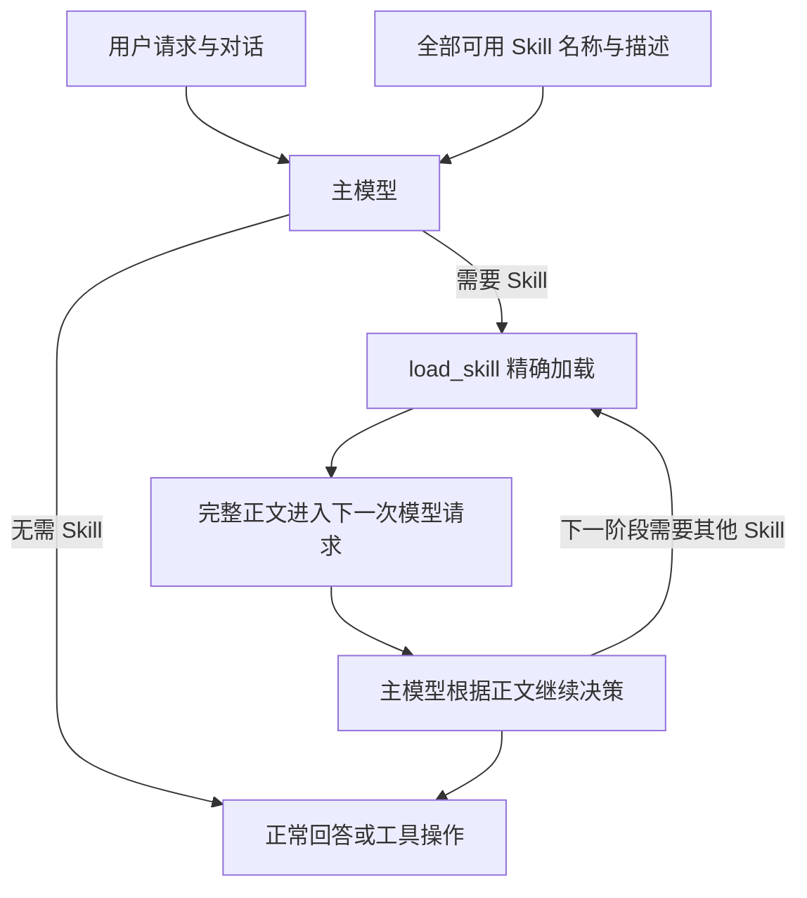

# Skill 模型主导选择改造提案

当前状态（2026-09-08，链路修复后）：默认已切换为 `model`，保留显式 `routed` 回退。小目录展示完整描述，大目录由主模型按 Directory 逐步发现；会话刷新与加载交接已接通。当前配置及行为以 [Skill 路由说明](skill-routing-v3.md) 为准。

## 历史实施记录（2026-09-08，第一步）

以下保留第一步当时的配置决策与评测结果，不代表当前默认值；旧评测结果不作追溯改写。

1. 新增配置 `skillSelection.mode ∈ {"routed"（默认）, "model"}`；环境变量 `MINI_CODE_SKILL_SELECTION_MODE` 可覆盖；非法值告警并回退 `routed`。routed 保持默认，model 为 opt-in。
2. model 模式已实现于 `minicode/skill_routing_turn.py`、`skill_router.py`、`prompt.py`、`config.py`，并在全部 5 个入口（含子代理）接线：system prompt 展示完整目录——每个 Skill 的 `qualified_name` 加完整描述（扣除约束否决项），以 "Available skills:" 为头并附 model-first 使用指引；加载策略＝全量授权目录减去显式禁用与约束否决（reason_code "model-catalog"），仅 deny_all 关闭整轮加载；意图解析仍运行（权限与约束否决依赖它），但评分、embedding 与候选重排在 model 模式下全部跳过；`required_skill_names` 在 model 模式下实际为空（不再有路由驱动的加载后交付强制）。
3. 加载批次屏障（`minicode/agent_loop.py`，与模式无关）：若模型响应的工具批次含有加载本任务尚未加载 Skill 的 `load_skill`，只执行 load 调用，批次内其他调用一律返回合成的 `ToolResult(ok=False, output="error[deferred_until_skill_loaded]: not executed in this batch; re-propose after reading the skill body")` 且不予派发；已加载的 Skill 不触发屏障。
4. 测试：新增 `tests/test_skill_load_batch_barrier.py`（4 项），并在 `tests/test_config.py`、`tests/test_skill_routing_turn.py`、`tests/test_skill_load_policy.py` 及 prompt 渲染测试补充单测覆盖。

与原提案文本的偏差：

- (a) model 模式下未解析／歧义的自然语言引用不再关闭加载，仅记入 outcome_reason（后缀 "-unresolved-not-enforced"／"-ambiguous-not-enforced"）；loader 对未知名称返回可纠正错误。
- (b) 已解决：加载策略改为 catalog 级作用域（`allow_catalog_scope`，子进程 payload v3，v2 仍可解析），任意规模目录保持 model 模式，不再降级 routed。
- (c) 已评测：2026-09-08 同题配对在线对照（20 题 × 2 臂，glm-5.3-flash，报告见 `artifacts/skill-selection-model-vs-routed-2026-09-08/REPORT.md`）显示 model 模式正例实际正确加载 12/17，低于 routed 的 15/17，负例误触发均为 0，输入 token +5%。单次运行、探测窗口偏窄，结论非终局；但按"只有可重复收益才切默认"的纪律，默认继续保持 `routed`，model 维持 opt-in。
- (d) 结构化强制／禁用接口（`/skill`、`/skills off`）仍未实现。

下文其余部分保留为后续步骤的设计参考。

规模修订：本文的全量 Skill 描述适用于预算内的小目录；千级目录推荐“Directory 描述常驻＋按需展开＋跨目录搜索”，意图解析保留为可纠正的任务线索。当前完整规模方案见 [分层发现与意图复用](skill-directory-discovery-proposal.md)。

## 决策建议

默认改为：**所有当前可用 Skill 的名称和完整描述常驻上下文，由执行任务的主模型选择，使用现有 `load_skill` 按需读取正文。** 意图解析、关键词、向量分数及候选重排退出 Skill 的前置选择路径。其他模块仍可使用意图解析，但它不决定 Skill 是否被展示或允许读取。

这次应替换默认流程的职责分配，而不继续围绕固定题目扩充触发词。模型的语义判断也会犯错；本提案解决新增能力必须符合既有分类体系的结构性问题，准确率提升需独立验证。

## 依据与纠正

现代码没有逐个针对 17 个 Skill id 写选择 if/else，`discover_skills` 已能发现新增文件。因此“新增 Skill 一定不能命中”过于绝对。实际限制来自固定意图／操作类型、双语概念词表、用途契约、activation terms、阈值及 top K：新增 Skill 即使描述明确，也可能无法进入候选。

更严重的是，`skill_load_policy_for_routing` 在有推荐时只允许加载推荐集合。仅把所有描述放入 prompt，模型自主选择其他合法 Skill 后仍会被拒绝，必须同时解除相关性评分与读取权限的绑定。

上一轮 20 题在线结果：严格检索 8/20；17 道正例实际正确加载 10/17，其中 4 道由主模型从名称回退目录补选；S14 主模型请求正确的 `code-skills/minicode-study`，却被正则切出的伪未知名称 `code-` 导致的策略拒绝。正文成功加载和传递的检查均保持完整，核心问题位于选择和授权解析。

本次只读测量：当前 17 个 Skill 的 `qualified_name + description` 加一行说明共 **2,213 字符、2,295 字节**；仓库字符启发式约 **567 token**，不是 GLM tokenizer 的精确计数或计费值。当前规模适合全目录可见，无需为省这部分上下文预先隐藏候选。见 `.repair-work/skill-model-first-design-2026-09-08/catalog-footprint.json`。

这个目录常驻、正文按需的原则也与 [Agent Skills 规范](https://agentskills.io/specification) 的渐进式加载一致；[实现指南](https://agentskills.io/client-implementation/adding-skills-support) 给出了模型直接基于目录激活 Skill 的接入方式。以下时序、权限和迁移方案针对本项目代码设计。

## 新流程



主模型可以选择零个、一个或多个 Skill。多步骤任务按阶段加载，不要求在第一轮预测所有条件分支。零 Skill 的请求不增加独立分类调用或空选择工具往返。

Skill 的最低注册信息为标准 `name`、`description` 和正文。`description` 描述用途与适用场景，必要时说明与相似技能的区别。`keywords`、`domains`、`supported_operations` 不再是新 Skill 被看见或加载的必需条件。支持完整的多行描述，解析失败应有明确诊断，不能悄悄只显示半句描述。

## 常驻目录与上下文

- 每个主模型请求都包含当前版本的一份目录段，固定排序。上下文压缩、恢复会话、切换任务后仍能看到它；“常驻”不等于每轮向历史追加一份副本。
- 描述放在单一 system 目录段，`load_skill` 工具 schema 可用当前合法名称 enum 限制参数，不再重复塞一份全描述。稳定布局有利于复用提示前缀，但实际缓存收益由 provider 决定。
- 正文只在需要时加载；参考文件继续按需读取。相同版本正文已完整存在当前上下文时可去重，不能因为历史上加载过就假设压缩后仍然存在。
- 新增／修改／禁用 Skill 在用户 turn 边界原子刷新：**catalog、目录段、loader 身份绑定、工具 schema 与模型的 schema 缓存**必须同步。正在运行的 turn 使用自身快照，不在一批工具执行中途换版本。只刷新 UI 列表不能算新 Skill 已生效。
- 当前已有 system 和成功 load call/result 的压缩保护，可复用并验证。长期运行还需管理活跃正文预算，避免所有曾加载正文无限累积；移除后再使用必须重新载入，而非仅记录“曾使用”。
- 未来目录超过预算，应显示实际容量问题或使用用户配置的项目 Skill 范围。不能静默恢复相关性 top K 后仍宣称全目录可见。现有 policy 还有 128 个 binding 上限，扩容前需同步评估；当前 17 个不受此限制。

## 语义判断和工程校验各自负责什么

| 交给主模型 | 保留为确定性工程约束 |
| --- | --- |
| 请求与 Skill 描述是否匹配 | 名称必须精确属于当前授权 catalog |
| 引用中的名称是否只是待处理素材 | 路径、目录逃逸、文件身份及正文 digest 校验 |
| 普通自然语言中的点名、禁用、偏好 | 来自真实 UI／命令／配置的强制和禁用状态 |
| 是否需要组合 Skill、何时进入下一阶段 | 父子任务权限交集、预算、取消、工具实际执行权限 |
| 工作流程是否与用户要求冲突、如何解释 | 正文完整读取、模型请求携带、失败状态及加载顺序 |

`load_policy` 的含义改为“当前主体允许读取哪些 Skill”，不再是“规则判断哪些 Skill 相关”。完整 catalog 的所有合法绑定可供选择；显式结构化限制从中扣除。不能为解除旧限制而把 policy 设为 `None`。

普通自然语言“使用 code-skills/minicode-study”交给主模型对照目录理解，不再用重叠正则制造未知名字并关闭整轮加载。模型请求不存在名称时，loader 返回针对该名称的可纠正错误，其他合法 Skill 仍可用；不做静默模糊替换。

强制指定或禁用需要硬保证时，使用真实用户操作产生的结构化状态，例如前端选择 Skill、`/skill <qualified_name>` 或 `/skills off`（拟议接口）。它们可以确定性解析并预加载／关闭入口；现有显式加载后才能完成的合约由这种确切来源驱动。普通自然语言禁用仍应遵从并加入行为测试，但不能宣称主模型语义理解是绝对可靠的硬权限机制。模型自己声称“用户允许”不能改写结构化权限。

Skill 中的 `required_operations` 可帮助模型解释流程冲突；读取说明不等于批准其中的命令。已有来自可信用户约束的实际执行限制仍生效，Skill 不得扩大写文件、运行命令、提交或网络权限。不要把旧的用途分类门槛换个名字移进新授权模块。

## 关键时序：先读正文，再决定动作

上一轮模型经常在同一个响应中发出 `load_skill` 和读文件请求。即使执行器先运行 loader，再运行读文件，模型也是在未见正文时制定两条动作，不能算按 Skill 规划。

新增一个与 Skill 语义无关的批次规则：

1. 在执行任何工具前检查完整批次。如果有需要新正文的 `load_skill`，先只处理加载请求。
2. 同批其他工具全部标明“未执行，需要读取 Skill 后重新提出”，保留完整工具调用关系，不伪造成功。无论 load 排在批次前还是后，都不能先执行其他动作。
3. 把真实正文／加载错误和明确的未执行结果完整回传，发起下一次主模型调用。
4. 模型看完结果后重新提出动作；执行器不自动恢复上一批旧动作。加载失败也先让模型看到原因。

全是普通工具的批次照常执行；不需要 Skill 的任务没有额外决策往返。多个 load 可以一起读取并回传。正文“已读文件”与“已进入模型请求”分别记录，避免把二者混成注入成功。

## 最小 Interface 与替换边界

建议统一的 Skill Module 对调用方只提供两个概念操作，具体类名可在实现时确定：

```text
prepare_skill_context(catalog_snapshot, trusted_user_policy, parent_policy)
  -> catalog_descriptions, load_policy, explicit_required_bindings

load_skill(qualified_name)
  -> 当前快照的完整正文、身份及版本证据
```

主模型的原始用户请求直接参与它自己的选择判断。准备目录的 Interface 不接收推断出来的 IntentType、相似度分数或 top K。

| 现模块 | 改造方向 |
| --- | --- |
| `skills.py`／`tools/__init__.py` | 保留自动发现和绑定；补齐完整描述解析、turn 边界原子刷新 |
| `skill_routing_turn.py`／新目录准备模块 | model 模式直接准备全目录及真实权限，不先过意图和候选门槛 |
| `prompt.py` | 明确的全描述目录模式；不用 names-only fallback 或 top-routed 文案冒充 |
| `skill_load_policy_for_routing` 的调用处 | 从授权 catalog 生成 policy；模型模式不依赖 selected |
| `tools/load_skill.py` | 保留精确绑定、正文完整性、实际加载事件 |
| `agent_loop.py` | 增加新正文加载批次屏障，保留原工具权限和错误机制 |
| CLI／TUI／Headless／Dashboard | 共用同一准备 Interface，避免出现某入口仍走旧路由 |
| 普通子任务 | 接收受父级权限约束的目录，同样能自主选择；父级推荐集合不再冒充授权全集 |
| Scheduler 的受限 Executor／只读工作单元 | 保留其 Assignment 限制；本改造不额外赋予通用 Skill 执行能力 |
| context／session／events | 版本一致、目录不重复、正文不丢失；available/requested/loaded/delivered 分别记录 |

不把全 catalog 填进旧 `selected` 字段，也不把旧相关性 fallback 文案留在主模型上下文。相关性候选、embedding 和 reranker 可暂留独立实验路径供对照，model 模式的模型失败应按真实请求失败处理，不能暗中切回旧硬规则。

## 为什么不先加一个独立 LLM 选择器

| 方案 | 取舍 |
| --- | --- |
| 主模型看完整目录，现有 load_skill 按需调用 | 推荐默认；可利用完整对话，无额外分类调用，新 Skill 直接进入描述目录 |
| 独立 LLM 先选，再把少数 Skill 给主模型 | 增加延迟和一个会漏选的前置入口；若其结果再变成白名单，主模型仍无法纠正 |
| 强制 use_skills([]/names) 或新增结构化决策字段 | 可增加审计信息，但强制空选择工具会引入无用往返；改同次响应协议又扩大适配面，当前没有必要 |

后续如观察到主模型经常漏选，应先检查描述、目录可见性与模型行为数据，再比较明确的结构化决策协议；不能先假设又一层选择器就更可靠。

## 实施与验收

建议先以 `skillSelection.mode=model` 的完整实现做对照，原模式仅保留为显式回滚／实验选项。迁移必须同时包含目录、policy、批次顺序、所有入口和 schema 刷新；只改 prompt 的版本不具备可评测的完整行为。验证后切换默认，并清理生产路径中不再需要的选择配置和接线。

验收分两类，避免把模型成功率与系统保证混为一谈：

**确定性契约应全部通过：**

- 实现冻结后新增只含 name、description、正文的 Skill，不改生产代码；下一 turn 目录、工具 schema、loader 均出现新版本，能完整加载。
- 全目录展示与实际可加载集合一致；显式结构化禁用、错误身份、旧 digest、父子权限边界仍有效。
- 同批 load＋任意其他动作时，动作在正文进入后续模型调用前零执行；失败不能绕过屏障。
- 对话压缩、会话恢复、目录变更、重名及重复加载不会造成丢失、重复或权限扩大。

**语义泛化必须独立盲测：**

- 原 20 题作为开发回归；额外由独立作者在实现冻结后加入 12 个新 Skill／48 个任务，只允许改 Skill 文件与任务数据。
- 同一任务使用口语改写、跨语言、去掉名称关键词；Skill 换名、目录顺序打乱、加入相似干扰项后重复测试。
- 覆盖零 Skill、引用标签、自然语言禁用、明确点名、多阶段条件任务。
- 分开报告选择请求、实际正确加载、正文交接、用户约束遵从、延迟／token 及模型超时；超时不算正确不触发。
- 相比原模式，正例实际正确加载应提升，负例误触发不应恶化；不能通过把不喜欢的 Skill 从目录隐藏来换分数。数值目标在盲测前确定，当前不承诺未经验证的准确率。

最终目标是可验证的扩展契约：**以后新增 Skill，改 Skill 文件即可；中央路由代码无需知道它的名字、领域或触发词。**
